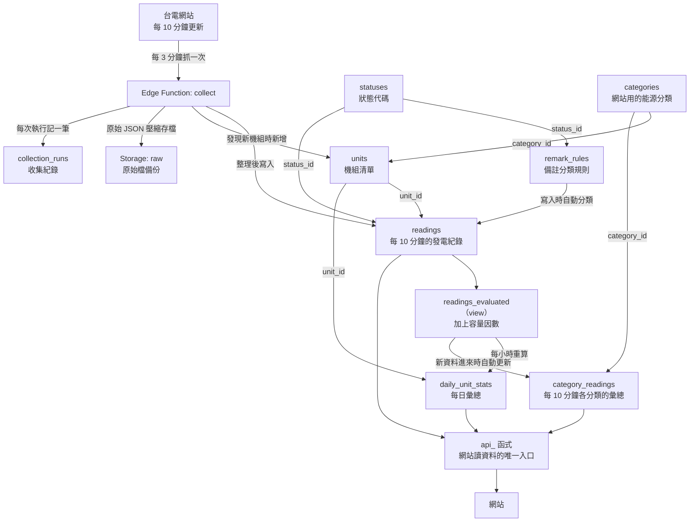

# 資料庫說明

這份文件說明 Supabase 資料庫裡有哪些資料表、每個欄位代表什麼。

> **維護規則：只要資料庫結構有改（新增、刪除、修改資料表、欄位、view 或排程），
> 就要在同一次修改裡同步更新這份文件。**

相關文件：

- 計算方法與假設：[methodology.md](methodology.md)
- 在 Supabase 網站上的操作步驟：[supabase-setup.md](supabase-setup.md)
- 資料庫的定義檔（SQL）：`supabase/migrations/`

---

## 1. 一眼看懂

資料庫裡有 8 張資料表、1 個 view，另外在 Storage（雲端硬碟）存原始檔。

| 名稱 | 種類 | 一筆資料代表什麼 | 原始還是算出來的 |
|---|---|---|---|
| [`readings`](#readings每-10-分鐘的發電紀錄) | 資料表 | 某個機組在某個時間點的發電狀況 | **原始資料** |
| [`units`](#units機組清單) | 資料表 | 一個機組 | **原始資料**（從台電的資料整理出來） |
| [`categories`](#categories網站用的能源分類) | 資料表 | 網站上的一個能源分類（例如「離岸風電」） | 我們自己訂的規則 |
| [`statuses`](#statuses狀態代碼) | 資料表 | 一種狀態（例如「停機」） | 我們自己訂的規則 |
| [`remark_rules`](#remark_rules備註分類規則) | 資料表 | 一條「備註 → 狀態」的對應規則 | 我們自己訂的規則 |
| [`collection_runs`](#collection_runs收集紀錄) | 資料表 | 收集程式執行了一次 | 系統紀錄 |
| [`daily_unit_stats`](#daily_unit_stats每日彙總) | 資料表 | 某個機組某一天的彙總 | **算出來的**，可以隨時重算 |
| [`category_readings`](#category_readings每-10-分鐘各分類的彙總) | 資料表 | 某個分類在某個時間點的合計 | **算出來的**，可以隨時重算 |
| [`readings_evaluated`](#readings_evaluated加上容量因數的發電紀錄) | view | 和 `readings` 一樣，多一欄容量因數 | **算出來的**，每次查詢時即時計算 |
| Storage 的 `raw` | 檔案 | 台電某個時間點的完整原始 JSON | **原始資料**（最原始的備份） |

**view 是什麼？** view 不存資料，它是一個「存起來的查詢」。
每次讀它，資料庫才去 `readings` 拿資料現算。所以 view 不佔空間，內容也永遠是最新的。

---

## 2. 資料表之間的關係



用文字說：

- `readings` 是核心。它的每一筆都用 `unit_id` 指向 `units` 的一個機組，
  用 `status_id` 指向 `statuses` 的一種狀態。
- `remark_rules` 決定「哪個備註對應哪個狀態」。資料寫進 `readings` 時，資料庫會自動查這張表來填 `status_id`。
- `units` 的每個機組用 `category_id` 指向 `categories` 的一個分類。
- `daily_unit_stats` 和 `category_readings` 完全是從 `readings` 算出來的。
- 網站不直接讀資料表，只透過 `api_` 開頭的函式讀資料（見第 7 節）。

---

## 3. 原始資料和算出來的資料

這個區分很重要：**原始資料漏了或壞了就補不回來；算出來的資料隨時可以刪掉重算。**

| 類別 | 包含 | 說明 |
|---|---|---|
| **原始資料** | `readings` 的 `observed_at`、`unit_id`、`capacity_mw`、`output_mw`、`remark`；`units`；Storage 的 `raw` | 來自台電。台電的歷史資料不提供裝置容量和備註，所以漏掉的時間點無法補回 |
| **規則** | `statuses`、`remark_rules`、`categories`；`units` 的 `category_id` 和 `name_en`；各表的英文名稱 | 我們自己訂的分類方式和翻譯，可以修改 |
| **算出來的** | `readings.status_id`；`readings_evaluated`；`daily_unit_stats`；`category_readings` | 由原始資料和規則算出來。規則改了，重算就好 |
| **系統紀錄** | `collection_runs` | 用來查收集有沒有正常運作，只保留 90 天 |

`readings.status_id` 比較特別：它存在原始資料的表裡，但它是由 `remark` 依規則算出來的。
修改 `remark_rules` 時，資料庫會自動把相關的舊資料重新分類。

---

## 4. 每張資料表的詳細說明

### `readings`：每 10 分鐘的發電紀錄

- **一筆資料代表**：某個機組在某個時間點的發電狀況。
- **多久新增一次**：台電每 10 分鐘更新一次，每次新增 191 筆（每個機組一筆）。一天約 27,500 筆。
- **從哪裡來**：Edge Function `collect` 每 3 分鐘抓一次台電的資料，由 `ingest_snapshot()` 整理後寫入。
  已經存過的時間點會自動略過。
- **不會重複**：同一個時間點、同一個機組只會有一筆（主鍵是 `observed_at` + `unit_id`）。
- **資料從哪天開始**：2026-11-13 00:00（台灣時間），第一個完整的一天。之前不完整的資料已用 `007_trim_early_data.sql` 排除（原始檔仍保存在 Storage 和 GitHub 的 `data/raw`）。

| 欄位 | 意思 | 單位／格式 | 來源 |
|---|---|---|---|
| `observed_at` | 台電資料的時間點 | 時間（台灣時間），每 10 分鐘一個，例如 `2026-11-13 10:10` | 台電 |
| `unit_id` | 哪個機組，對應 `units.id` | 編號 | 台電（經過對應） |
| `capacity_mw` | 裝置容量 | **MW**。台電顯示「-」時是空值 | 台電 |
| `output_mw` | 淨發電量 | **MW**。台電顯示「N/A」時是空值。抽蓄水力抽水、儲能充電時可能是負數 | 台電 |
| `remark` | 備註原文，例如 `檢修`。正常運轉時是空字串 | 文字 | 台電 |
| `status_id` | 狀態代碼，對應 `statuses.id` | 1～7 | **算出來的**（由 `remark` 依 `remark_rules` 自動填） |

**MW 是什麼？** MW（百萬瓦）是「功率」，表示某一刻發電的強度。
要換算成發電量（度），要乘上時間：1 MW 持續發電 1 小時 = 1 MWh = 1,000 度。

### `units`：機組清單

- **一筆資料代表**：一個機組（或台電合併成一列的一組機組，例如「其它購電太陽能」）。
- **多久新增一次**：很少。只有台電的資料裡出現沒看過的機組時，才會自動新增一筆。目前共 191 筆。
- **從哪裡來**：`ingest_snapshot()` 從台電資料的「機組類型」和「機組名稱」整理出來。

| 欄位 | 意思 | 單位／格式 | 來源 |
|---|---|---|---|
| `id` | 機組的固定編號，給了就不會變 | 編號（1、2、3…） | 資料庫自動產生 |
| `type` | 台電的機組類型，例如 `風力`、`民營電廠-燃氣` | 文字 | 台電 |
| `name` | 機組名稱，已去掉「(註10)」這類註記，例如 `沃一風` | 文字 | 台電 |
| `is_renewable` | 是不是再生能源（太陽能、風力、水力、其它再生能源） | 是／否 | 由 `type` 判斷 |
| `footnote` | 最近一次看到的註記編號，例如 `10`；沒有就是空字串 | 文字 | 台電 |
| `category_id` | 網站用的能源分類，對應 `categories.id` | 1～11 | 我們訂的（新機組自動給預設值） |
| `name_en` | 機組的英文名稱。沒有時是空值，網站會改顯示中文名稱 | 文字 | 我們翻譯的 |
| `notified_at` | 寄過「新機組通知信」的時間。空值＝還沒通知過的新機組 | 時間 | 收集程式寄信後填上 |
| `first_seen_at` | 這個機組第一次出現在資料裡的時間 | 時間 | 算出來的 |
| `last_seen_at` | 這個機組最後一次出現在資料裡的時間 | 時間 | 算出來的 |

「類型 + 名稱」不能重複。因為不同類型裡有同名的機組（太陽能和風力都有「其它台電自有」），
所以要兩個一起看才能確定是哪個機組。

**分類怎麼決定**：台電出現新機組時，資料庫依它的 `type` 自動給預設分類
（`default_category_id()`）。風力一律預設成「陸域風電」，因為台電的資料沒有區分陸域和離岸。
**新的離岸風場要手動改成 11**，然後執行 `select refresh_category_readings();` 重算彙總：

```sql
update units set category_id = 11 where type = '風力' and name = '新風場的名稱';
select refresh_category_readings();
```

**新機組通知**：台電出現新機組時，收集程式會寄一封信通知（`008_new_unit_notices.sql`、Edge Function `collect`）。
信裡會列出需要決定的事：每個新機組的英文名稱；風力機組是陸域還是離岸；
台電類型沒看過的機組要歸哪一類（決定之前 `category_id` 是空值，不會出現在網站的各能源統計裡）。

### `categories`：網站用的能源分類

- **一筆資料代表**：網站上的一個能源分類。
- **多久新增一次**：固定 11 筆，不會自動新增。
- **從哪裡來**：我們自己訂的，寫在 `005_website_api.sql`。
- **為什麼需要**：台電的「機組類型」沒有區分陸域和離岸風電，
  而且「燃料油」和「汽電共生」在網站上合併成一類。所以另外訂一套分類。

| 欄位 | 意思 | 單位／格式 |
|---|---|---|
| `id` | 分類編號 | 1～11 |
| `code` | 程式用的英文代號，例如 `wind_offshore` | 文字 |
| `name_zh` | 中文名稱 | 文字 |
| `name_en` | 英文名稱 | 文字 |
| `is_renewable` | 是不是再生能源 | 是／否 |
| `sort_order` | 堆疊圖由下到上的順序 | 1～11 |

| id | code | 中文 | 英文 | 包含台電的哪些類型 |
|---|---|---|---|---|
| 1 | `coal` | 燃煤 | Coal | 燃煤 |
| 2 | `ipp_coal` | 民營燃煤 | IPP Coal | 民營電廠-燃煤 |
| 3 | `gas` | 燃氣 | Gas | 燃氣 |
| 4 | `ipp_gas` | 民營燃氣 | IPP Gas | 民營電廠-燃氣 |
| 5 | `other_thermal` | 其它火力 | Other Thermal | 燃料油、汽電共生 |
| 6 | `storage` | 儲能 | Storage | 儲能 |
| 7 | `hydro` | 水力 | Hydro | 水力 |
| 8 | `other_renewable` | 其它再生能源 | Other Renewables | 其它再生能源 |
| 9 | `solar` | 太陽能 | Solar | 太陽能 |
| 10 | `wind_onshore` | 陸域風電 | Onshore Wind | 風力（不在離岸名單裡的） |
| 11 | `wind_offshore` | 離岸風電 | Offshore Wind | 風力（離岸名單裡的 16 個風場） |

### `statuses`：狀態代碼

- **一筆資料代表**：一種狀態。
- **多久新增一次**：固定 7 筆，不會自動新增。
- **從哪裡來**：我們自己訂的，寫在 `001_schema.sql`。

| 欄位 | 意思 | 單位／格式 |
|---|---|---|
| `id` | 狀態代碼 | 1～7 |
| `name` | 狀態名稱（中文） | 文字 |
| `name_en` | 狀態名稱（英文） | 文字 |
| `excluded_from_stats` | 這個狀態的時間點**不列入**容量因數的計算 | 是／否 |
| `flagged` | 網站上要特別標註（檢修、故障等） | 是／否 |

目前的 7 種狀態：

| id | name | 不列入計算 | 要標註 |
|---|---|---|---|
| 1 | 正常 | | |
| 2 | 主動少發 | | |
| 3 | 部分停機 | | ✓ |
| 4 | 停機 | | ✓ |
| 5 | 狀態不明 | ✓ | |
| 6 | 試運轉 | ✓ | |
| 7 | 其他備註 | | ✓ |

### `remark_rules`：備註分類規則

- **一筆資料代表**：一條規則，「這個備註屬於哪個狀態」。
- **多久新增一次**：台電出現新的備註、而且我們決定好怎麼分類時，手動加一筆。目前 18 筆。
- **從哪裡來**：我們自己訂的。必須和 `capacity_factor.py` 的 `REMARK_RULES` 完全一樣
  （`tests/test_rules_match.py` 會檢查）。

| 欄位 | 意思 | 單位／格式 |
|---|---|---|
| `remark` | 台電的備註原文，例如 `部分檢修`。空字串代表「沒有備註」 | 文字 |
| `status_id` | 對應的狀態，對應 `statuses.id` | 1～7 |
| `remark_en` | 備註的英文翻譯。規則表裡沒有的備註，網站會顯示中文原文 | 文字 |

「其他備註」（7）是不屬於前幾類的備註，例如「合約限制」、「計劃停機」、「環保檢測」。
網站上不另外歸類，直接顯示備註原文。規則表裡沒有的新備註，也會被歸為 7。
新增、修改、刪除規則時，`readings` 裡有那個備註的舊資料會自動重新分類。

### `collection_runs`：收集紀錄

- **一筆資料代表**：收集程式執行了一次（不管有沒有抓到新資料）。
- **多久新增一次**：Supabase 的排程每 3 分鐘一筆，一天約 480 筆。GitHub 備援和手動匯入也會各記一筆。
- **從哪裡來**：成功時由 `ingest_snapshot()` 寫入，失敗時由 `log_collection_failure()` 寫入。
- **保留多久**：90 天，更舊的每天自動刪除。

| 欄位 | 意思 | 單位／格式 |
|---|---|---|
| `id` | 流水號 | 編號 |
| `run_at` | 這次執行的時間 | 時間 |
| `source` | 誰執行的：`supabase`（主要排程）、`github`（備援）、`import`（手動匯入舊資料） | 文字 |
| `ok` | 成功還是失敗 | 是／否 |
| `data_time` | 這次抓到的台電資料時間。失敗時是空值 | 時間 |
| `units_seen` | 這次的資料裡有幾個機組 | 個 |
| `rows_inserted` | 實際新增到 `readings` 的筆數。**0 表示這個時間點之前已經存過**，是正常的 | 筆 |
| `message` | 失敗時的錯誤訊息 | 文字 |

### `daily_unit_stats`：每日彙總

- **一筆資料代表**：某個機組某一天的彙總數字。
- **多久新增一次**：每天每個機組一筆，一天 191 筆。
  每小時的第 20 分會重算「今天」和「昨天」，所以今天的數字會隨時間更新。
- **從哪裡來**：`refresh_daily_stats()` 從 `readings_evaluated` 算出來。**整張表都是算出來的**，可以隨時重算。
- **不會重複**：同一天、同一個機組只會有一筆（主鍵是 `day` + `unit_id`）。

| 欄位 | 意思 | 單位／格式 |
|---|---|---|
| `day` | 日期（台灣時間的 00:00～23:50 算一天） | 日期 |
| `unit_id` | 哪個機組，對應 `units.id` | 編號 |
| `generation_kwh` | 當天的發電量 ＝ 當天平均淨發電量 × 24 小時 × 1000 | **度**（kWh） |
| `capacity_factor` | 當天每 10 分鐘容量因數的平均。算不出來時是空值 | **0～1 的小數**。乘以 100 才是 %，例如 `0.52` 是 52% |
| `capacity_mw` | 當天最後一筆的裝置容量 | **MW** |
| `intervals_present` | 當天收到幾個時間點 | 個（一天最多 144） |
| `intervals_valid` | 其中能算容量因數的有幾個 | 個 |
| `completeness` | 資料完整度 ＝ `intervals_present` ÷ 144 | **0～1 的小數**。乘以 100 才是 % |
| `flagged_remarks` | 當天出現的停機類備註和次數，例如 `{"部分檢修": 12, "檢修": 3}` | JSON |
| `computed_at` | 這筆是什麼時候算出來的 | 時間 |

注意：

- 今天還沒過完時，`generation_kwh` 是用「到目前為止的平均」估算整天，不是實際累計。
- 沒有裝置容量的機組，`capacity_factor` 和 `capacity_mw` 是空值，但 `generation_kwh` 照樣有數字。
- 手動重算某一天：`select refresh_daily_stats('2026-11-12');`

### `category_readings`：每 10 分鐘各分類的彙總

- **一筆資料代表**：某個分類（例如「離岸風電」）在某個時間點的合計。
- **多久新增一次**：台電每 10 分鐘更新一次，每次新增 11 筆（每個分類一筆）。
- **從哪裡來**：`readings` 有新資料寫入時，資料庫自動算出那個時間點的 11 筆
  （`readings_refresh_categories` 觸發器）。**整張表都是算出來的**，可以隨時重算。
- **為什麼要另外存**：首頁的堆疊圖每次都要「11 類 × 幾百個時間點」的數字。
  每次都從 191 個機組現算太慢，先算好存起來，網站讀起來才快。

| 欄位 | 意思 | 單位／格式 |
|---|---|---|
| `observed_at` | 台電資料的時間點 | 時間 |
| `category_id` | 哪個分類，對應 `categories.id` | 1～11 |
| `output_mw` | 這一類全部機組的淨發電量加總 | **MW** |
| `capacity_mw` | 這一類有裝置容量的機組，裝置容量加總 | **MW** |
| `capacity_factor` | 這一類的容量因數：只計入「能算容量因數」的機組，用發電量加總 ÷ 裝置容量加總 | **0～1 的小數** |
| `unit_count` | 這一類有幾個機組 | 個 |

改了機組的分類之後，要全部重算一次：`select refresh_category_readings();`

### `readings_evaluated`：加上容量因數的發電紀錄

- **種類**：view（不存資料，查詢時即時計算）。
- **一筆資料代表**：和 `readings` 的一筆一樣，多了兩欄。
- **從哪裡來**：`readings` 加上 `statuses`。

| 欄位 | 意思 | 單位／格式 |
|---|---|---|
| `observed_at`、`unit_id`、`capacity_mw`、`output_mw`、`status_id`、`remark` | 和 `readings` 完全一樣 | |
| `flagged` | 這個狀態要不要特別標註（來自 `statuses.flagged`） | 是／否 |
| `capacity_factor` | 這 10 分鐘的容量因數 ＝ 發電量 ÷ 裝置容量，限制在 0～1 之間 | **0～1 的小數** |

`capacity_factor` 在這些情況下是空值：沒有裝置容量、沒有發電量數字、
狀態是「不列入計算」（試運轉、通訊異常）。詳細理由見 [methodology.md](methodology.md)。

### Storage 的 `raw`：原始檔備份

- **一個檔案代表**：台電某個時間點的完整原始 JSON，用 gzip 壓縮。
- **多久新增一次**：每 10 分鐘一個檔案，每個約 3.5 KB。
- **路徑**：`raw/日期/時分.json.gz`，例如 `raw/2026-11-12/1010.json.gz`。
- **用途**：保險。資料庫裡的是「整理過」的資料；萬一整理的程式有 bug，可以從原始檔重新整理。
  它也保留了資料庫沒有存的內容（例如「小計」列、「儲能負載」列）。
- **不公開**：只有收集程式能讀寫。

---

## 5. 自動執行的排程

排程由 pg_cron（資料庫內建的鬧鐘）執行。pg_cron 的時間是 UTC，比台灣時間慢 8 小時。

| 排程名稱 | 多久一次 | 做什麼 | 定義在 |
|---|---|---|---|
| `collect-taipower` | 每 3 分鐘 | 呼叫 Edge Function `collect` 抓台電資料 | `002_schedule.sql` |
| `refresh-daily-stats` | 每小時的第 20 分 | 重算 `daily_unit_stats` 的今天和昨天 | `003_daily_stats.sql` |
| `cleanup-logs` | 每天台灣時間 03:07 | 刪除 90 天前的 `collection_runs`、7 天前的排程執行紀錄 | `002_schedule.sql` |

## 6. 資料庫裡的函式

函式是存在資料庫裡的小程式。一般不需要自己呼叫，列在這裡是為了查問題時知道它們在做什麼。

| 函式 | 用途 |
|---|---|
| `ingest_snapshot(raw, source)` | 把一份台電原始 JSON 整理後寫進 `units`、`readings`、`collection_runs`。**所有整理資料的規則都在這裡** |
| `log_collection_failure(source, message)` | 收集失敗時在 `collection_runs` 記一筆 |
| `refresh_daily_stats(day)` | 重算某一天的 `daily_unit_stats` |
| `refresh_category_readings(from, to)` | 重算一段時間的 `category_readings`。不給參數就是全部重算 |
| `default_category_id(type)` | 台電的機組類型對應到哪個預設分類 |
| `pending_unit_notices()` | 列出還沒通知過的新機組，以及需要使用者決定的分類問題 |
| `mark_units_notified(ids)` | 新機組通知信寄出後，標記成已通知 |
| `missing_slots(days)` | 列出最近幾天缺了哪些時間點。用法：`select * from missing_slots(2);` |
| `classify_remark(remark)` | 查某個備註對應的狀態代碼 |
| `parse_taipower_number(text)` | 把台電的數字字串轉成數字（`"742.7"` → 742.7，`"-"` → 空值） |

## 7. 誰可以讀寫，以及網站怎麼讀資料

所有資料表都開了 RLS（Row Level Security），而且沒有設定任何開放規則。意思是：

- **secret 金鑰**（收集程式、備援程式用）：可以讀寫全部資料。
- **anon 金鑰**（可以公開的那把，網站用這把）：**不能直接讀寫任何資料表**，
  只能呼叫下面這幾個 `api_` 開頭的函式。

這樣設計的好處：只開放網站需要的內容；每個函式都限制了時間範圍，
不會被人拿來一次撈走全部資料；資料表的結構之後要改，只要函式回傳的格式不變，網站就不受影響。

| 函式 | 回傳什麼 | 限制 |
|---|---|---|
| `api_meta()` | 分類、狀態、備註的中英文；全部機組的清單和最新一筆的數字；資料的起訖時間 | |
| `api_category_series(開始, 結束, 粒度)` | 各分類的發電量（MW）和容量因數的時間序列 | 粒度 `10min` 最多 8 天、`hour` 最多 100 天、`day` 最多 5 年 |
| `api_unit_series(開始, 結束, 分類, 機組)` | 機組每 10 分鐘的發電量（MW）、狀態代碼和備註原文。狀態 0 代表那個時間點沒有資料 | 最多 8 天；分類和機組至少要給一個 |
| `api_daily(開始日, 結束日, 分類, 機組)` | 每日彙總（發電量、容量因數等） | 沒指定機組最多 62 天；指定單一機組最多 5 年 |

`hour` 和 `day` 粒度回傳的是那段時間內每 10 分鐘數值的平均。

---

## 8. 未來規劃

以下是已經想到、**現在還沒建立**的東西。等真的要做時再建，並更新這份文件。

### 月報的官方可用率：`monthly_unit_reports`

**背景**：即時資料算不出真正的可用率（原因見 [methodology.md](methodology.md)）。
日後如果要呈現可用率，會改用月報裡的官方數字。

**為什麼要另開一張表，不放進現有的表**：

- 來源不同：月報是另一份資料，不是每 10 分鐘的即時資料。
- 頻率不同：一個月一筆，不是一天一筆或 10 分鐘一筆。
- 性質不同：它是**原始資料**（官方公布的數字），不是我們算出來的。
  混進 `daily_unit_stats` 這種「可以隨時重算」的表，重算時會被清掉。

**預計的樣子**（欄位要等拿到實際的月報格式後才能確定）：

| 欄位 | 意思 |
|---|---|
| 月份 | 這筆是哪個月的 |
| 機組 | 對應 `units.id` |
| 官方可用率 | 月報公布的數字 |
| 資料來源 | 哪一份月報 |

### 機組名稱對照表

**為什麼需要**：月報裡的機組名稱，不一定和即時資料的名稱一樣
（例如寫法不同，或月報是以整座電廠為單位，即時資料是以個別機組為單位）。
要把月報的數字接到 `units` 的機組上，需要一張對照表：「月報裡的這個名稱 = `units` 裡的這個機組」。

**預計的樣子**：

| 欄位 | 意思 |
|---|---|
| 月報裡的名稱 | 月報上寫的機組或電廠名稱 |
| 機組 | 對應 `units.id` |

如果月報的一個名稱對應到多個機組（例如一座電廠有好幾部機組），到時候要決定可用率怎麼分配或呈現。

### 其他已知會需要的

- 更可靠的警報（現在的 GitHub 備援連不到台電，幫不上忙）。
- 日後如果改成需要登入，Supabase 內建登入功能，`api_` 函式的權限要跟著調整。
