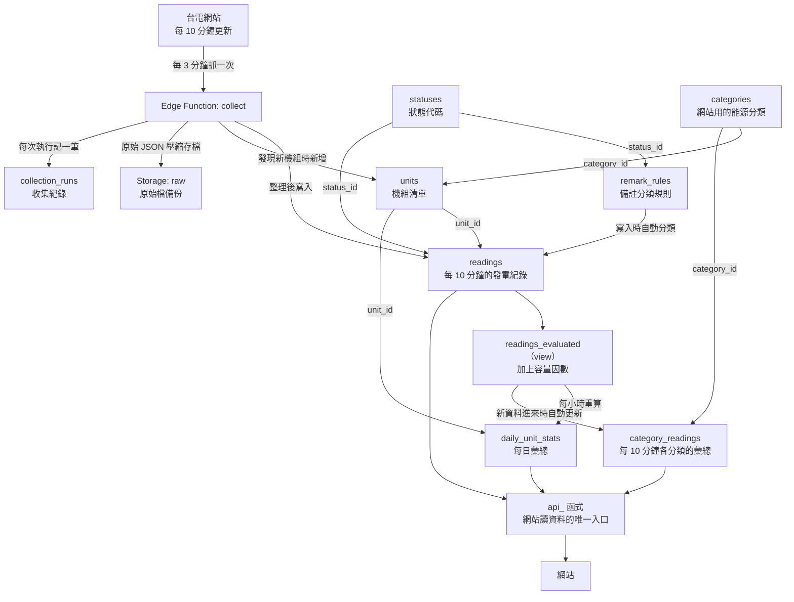

# 資料庫說明

這份文件說明 Supabase 資料庫裡有哪些資料表、每個欄位代表什麼。

> **維護規則：只要資料庫結構有改（新增、刪除、修改資料表、欄位、view 或排程），
> 就要在同一次修改裡同步更新這份文件。**

相關文件：

- 計算方法與假設：[methodology.md](methodology.md)
- 在 Supabase 網站上的操作步驟：[supabase-setup.md](supabase-setup.md)
- 資料庫的定義檔（SQL）：`supabase/migrations/`

---

## 1. 一眼看懂

資料庫裡有 24 張資料表、4 個 view，另外在 Storage（雲端硬碟）存原始檔。
其中 9 張和「即時發電資料」有關（下表上半部），6 張是人工整理的「電價與轉供費率」，
9 張是「業者排名」（T-REC 憑證資料和業者名單，下表最下面，見第 4 節最後）。

| 名稱 | 種類 | 一筆資料代表什麼 | 原始還是算出來的 |
|---|---|---|---|
| [`readings`](#readings每-10-分鐘的發電紀錄) | 資料表 | 某個機組在某個時間點的發電狀況 | **原始資料** |
| [`units`](#units機組清單) | 資料表 | 一個機組 | **原始資料**（從台電的資料整理出來） |
| [`categories`](#categories網站用的能源分類) | 資料表 | 網站上的一個能源分類（例如「離岸風電」） | 我們自己訂的規則 |
| [`statuses`](#statuses狀態代碼) | 資料表 | 一種狀態（例如「停機」） | 我們自己訂的規則 |
| [`remark_rules`](#remark_rules備註分類規則) | 資料表 | 一條「備註 → 狀態」的對應規則 | 我們自己訂的規則 |
| [`collection_runs`](#collection_runs收集紀錄) | 資料表 | 收集程式執行了一次 | 系統紀錄 |
| [`usage_checks`](#usage_checks用量紀錄) | 資料表 | 某一天的資料庫和 Storage 用量 | 系統紀錄 |
| [`daily_unit_stats`](#daily_unit_stats每日彙總) | 資料表 | 某個機組某一天的彙總 | **算出來的**，可以隨時重算 |
| [`category_readings`](#category_readings每-10-分鐘各分類的彙總) | 資料表 | 某個分類在某個時間點的合計 | **算出來的**，可以隨時重算 |
| [`readings_evaluated`](#readings_evaluated加上容量因數的發電紀錄) | view | 和 `readings` 一樣，多一欄容量因數 | **算出來的**，每次查詢時即時計算 |
| Storage 的 `raw` | 檔案 | 台電某個時間點的完整原始 JSON | **原始資料**（最原始的備份） |
| [`avg_unit_prices`](#avg_unit_prices歷年平均單價) | 資料表 | 某一年某一類用電的平均單價 | **人工整理的原始資料** |
| [`unit_costs`](#unit_costs每度售電成本) | 資料表 | 某一年的每度售電成本 | **人工整理的原始資料** |
| [`price_adjustments`](#price_adjustments電價調整時間軸) | 資料表 | 一次電價審議的結果（調漲、調降、不調整、延後） | **人工整理的原始資料** |
| [`wheeling_rates`](#wheeling_rates轉供費率) | 資料表 | 某一年某一種轉供費率（平均、再生能源、各燃料別） | **人工整理的原始資料** |
| [`wheeling_rate_docs`](#wheeling_rate_docs轉供費率的台電公告原檔) | 資料表 | 某一年台電公告的費率方案原檔（PDF） | **人工整理的原始資料** |
| [`required_unit_prices`](#required_unit_prices應有單價) | 資料表 | 一場審議會上台電提報的應有單價 | **人工整理的原始資料** |
| [`companies`](#companies業者基本資料) | 資料表 | 一家售電業或發電業者 | **人工整理的原始資料** |
| [`trec_certificates`](#trec_certificatest-rec-已發放憑證) | 資料表 | T-REC 某個案場某一年發放的憑證 | **原始資料**（每月自動抓） |
| [`trec_direct_supply`](#trec_direct_supplyt-rec-直轉供成交紀錄) | 資料表 | 一年內某出售單位把某案場的憑證賣給某買方 | **原始資料**（每月自動抓） |
| [`trec_self_use_trades`](#trec_self_use_tradest-rec-自用發電設備成交紀錄) | 資料表 | 一筆自用發電設備的憑證成交 | **原始資料**（每月自動抓） |
| [`trec_year_totals`](#trec_year_totals每一年的驗算) | 資料表 | 某一年三份 T-REC 資料的總量驗算 | 系統紀錄 |
| [`trec_sync_runs`](#trec_sync_runs與-trec_staging) | 資料表 | 每月自動抓取執行了一次 | 系統紀錄 |
| [`trec_staging`](#trec_sync_runs與-trec_staging) | 資料表 | 自動抓取時的暫存區（平常是空的） | 系統暫存 |
| [`company_reports`](#company_reports與-company_financials) | 資料表 | 一份業者的年報或月報（連結） | **人工整理的原始資料**（第 2 階段） |
| [`company_financials`](#company_reports與-company_financials) | 資料表 | 一家業者一年的財務數字 | **人工整理的原始資料**（第 3 階段） |
| [`company_public_filings`](#company_public_filings上市櫃公開資訊) | 資料表 | 一家業者一年的財報數字（業者自己或母公司的官方文件） | **人工整理的原始資料**（022） |
| [`company_rankings`](#view-company_rankings與-trec_unknown_sellers) | view | 售電業、發電業各自依累計直轉供移轉量排名 | **算出來的** |
| [`trec_unknown_sellers`](#view-company_rankings與-trec_unknown_sellers) | view | T-REC 上有、但業者名單沒有的公司 | **算出來的** |
| [`company_unit_metrics`](#company_reports與-company_financials) | view | `company_financials` 加上每度電的單價（推估） | **算出來的** |

**view 是什麼？** view 不存資料，它是一個「存起來的查詢」。
每次讀它，資料庫才去 `readings` 拿資料現算。所以 view 不佔空間，內容也永遠是最新的。

---

## 2. 資料表之間的關係



用文字說：

- `readings` 是核心。它的每一筆都用 `unit_id` 指向 `units` 的一個機組，
  用 `status_id` 指向 `statuses` 的一種狀態。
- `remark_rules` 決定「哪個備註對應哪個狀態」。資料寫進 `readings` 時，資料庫會自動查這張表來填 `status_id`。
- `units` 的每個機組用 `category_id` 指向 `categories` 的一個分類。
- `daily_unit_stats` 和 `category_readings` 完全是從 `readings` 算出來的。
- 網站不直接讀資料表，只透過 `api_` 開頭的函式讀資料（見第 7 節）。

---

## 3. 原始資料和算出來的資料

這個區分很重要：**原始資料漏了或壞了就補不回來；算出來的資料隨時可以刪掉重算。**

| 類別 | 包含 | 說明 |
|---|---|---|
| **原始資料** | `readings` 的 `observed_at`、`unit_id`、`capacity_mw`、`output_mw`、`remark`；`units`；Storage 的 `raw` | 來自台電。台電的歷史資料不提供裝置容量和備註，所以漏掉的時間點無法補回 |
| **規則** | `statuses`、`remark_rules`、`categories`；`units` 的 `category_id` 和 `name_en`；各表的英文名稱 | 我們自己訂的分類方式和翻譯，可以修改 |
| **算出來的** | `readings.status_id`；`readings_evaluated`；`daily_unit_stats`；`category_readings` | 由原始資料和規則算出來。規則改了，重算就好 |
| **系統紀錄** | `collection_runs`、`usage_checks` | 用來查收集和用量有沒有正常，`collection_runs` 只保留 90 天 |
| **人工整理的原始資料** | `avg_unit_prices`、`unit_costs`、`price_adjustments`、`wheeling_rates`、`wheeling_rate_docs`、`required_unit_prices` | 從台電、能源署等官方文件人工抄錄，不是自動收集的。要更新時改 `010_electricity_price.sql` 再執行一次 |

`readings.status_id` 比較特別：它存在原始資料的表裡，但它是由 `remark` 依規則算出來的。
修改 `remark_rules` 時，資料庫會自動把相關的舊資料重新分類。

---

## 4. 每張資料表的詳細說明

### `readings`：每 10 分鐘的發電紀錄

- **一筆資料代表**：某個機組在某個時間點的發電狀況。
- **多久新增一次**：台電每 10 分鐘更新一次，每次新增 191 筆（每個機組一筆）。一天約 27,500 筆。
- **從哪裡來**：Edge Function `collect` 每 3 分鐘抓一次台電的資料，由 `ingest_snapshot()` 整理後寫入。
  已經存過的時間點會自動略過。
- **不會重複**：同一個時間點、同一個機組只會有一筆（主鍵是 `observed_at` + `unit_id`）。
- **資料從哪天開始**：2026-11-13 00:00（台灣時間），第一個完整的一天。之前不完整的資料已用 `007_trim_early_data.sql` 排除（原始檔仍保存在 Storage 和 GitHub 的 `data/raw`）。

| 欄位 | 意思 | 單位／格式 | 來源 |
|---|---|---|---|
| `observed_at` | 台電資料的時間點 | 時間（台灣時間），每 10 分鐘一個，例如 `2026-11-13 10:10` | 台電 |
| `unit_id` | 哪個機組，對應 `units.id` | 編號 | 台電（經過對應） |
| `capacity_mw` | 裝置容量 | **MW**。台電顯示「-」時是空值 | 台電 |
| `output_mw` | 淨發電量 | **MW**。台電顯示「N/A」時是空值。抽蓄水力抽水、儲能充電時可能是負數 | 台電 |
| `remark` | 備註原文，例如 `檢修`。正常運轉時是空字串 | 文字 | 台電 |
| `status_id` | 狀態代碼，對應 `statuses.id` | 1～7 | **算出來的**（由 `remark` 依 `remark_rules` 自動填） |

**MW 是什麼？** MW（百萬瓦）是「功率」，表示某一刻發電的強度。
要換算成發電量（度），要乘上時間：1 MW 持續發電 1 小時 = 1 MWh = 1,000 度。

### `units`：機組清單

- **一筆資料代表**：一個機組（或台電合併成一列的一組機組，例如「其它購電太陽能」）。
- **多久新增一次**：很少。只有台電的資料裡出現沒看過的機組時，才會自動新增一筆。目前共 191 筆。
- **從哪裡來**：`ingest_snapshot()` 從台電資料的「機組類型」和「機組名稱」整理出來。

| 欄位 | 意思 | 單位／格式 | 來源 |
|---|---|---|---|
| `id` | 機組的固定編號，給了就不會變 | 編號（1、2、3…） | 資料庫自動產生 |
| `type` | 台電的機組類型，例如 `風力`、`民營電廠-燃氣` | 文字 | 台電 |
| `name` | 機組名稱，已去掉「(註10)」這類註記，例如 `沃一風` | 文字 | 台電 |
| `is_renewable` | 是不是再生能源（太陽能、風力、水力、其它再生能源） | 是／否 | 由 `type` 判斷 |
| `footnote` | 最近一次看到的註記編號，例如 `10`；沒有就是空字串 | 文字 | 台電 |
| `category_id` | 網站用的能源分類，對應 `categories.id` | 1～11 | 我們訂的（新機組自動給預設值） |
| `name_en` | 機組的英文名稱。沒有時是空值，網站會改顯示中文名稱 | 文字 | 我們翻譯的 |
| `notified_at` | 寄過「新機組通知信」的時間。空值＝還沒通知過的新機組 | 時間 | 收集程式寄信後填上 |
| `first_seen_at` | 這個機組第一次出現在資料裡的時間 | 時間 | 算出來的 |
| `last_seen_at` | 這個機組最後一次出現在資料裡的時間 | 時間 | 算出來的 |

「類型 + 名稱」不能重複。因為不同類型裡有同名的機組（太陽能和風力都有「其它台電自有」），
所以要兩個一起看才能確定是哪個機組。

**分類怎麼決定**：台電出現新機組時，資料庫依它的 `type` 自動給預設分類
（`default_category_id()`）。風力一律預設成「陸域風電」，因為台電的資料沒有區分陸域和離岸。
**新的離岸風場要手動改成 11**，然後執行 `select refresh_category_readings();` 重算彙總：

```sql
update units set category_id = 11 where type = '風力' and name = '新風場的名稱';
select refresh_category_readings();
```

**新機組通知**：台電出現新機組時，收集程式會寄一封信通知（`008_new_unit_notices.sql`、Edge Function `collect`）。
信裡會列出需要決定的事：每個新機組的英文名稱；風力機組是陸域還是離岸；
台電類型沒看過的機組要歸哪一類（決定之前 `category_id` 是空值，不會出現在網站的各能源統計裡）。

### `categories`：網站用的能源分類

- **一筆資料代表**：網站上的一個能源分類。
- **多久新增一次**：固定 11 筆，不會自動新增。
- **從哪裡來**：我們自己訂的，寫在 `005_website_api.sql`。
- **為什麼需要**：台電的「機組類型」沒有區分陸域和離岸風電，
  而且「燃料油」和「汽電共生」在網站上合併成一類。所以另外訂一套分類。

| 欄位 | 意思 | 單位／格式 |
|---|---|---|
| `id` | 分類編號 | 1～11 |
| `code` | 程式用的英文代號，例如 `wind_offshore` | 文字 |
| `name_zh` | 中文名稱 | 文字 |
| `name_en` | 英文名稱 | 文字 |
| `is_renewable` | 是不是再生能源 | 是／否 |
| `sort_order` | 堆疊圖由下到上的順序 | 1～11 |

| id | code | 中文 | 英文 | 包含台電的哪些類型 |
|---|---|---|---|---|
| 1 | `coal` | 燃煤 | Coal | 燃煤 |
| 2 | `ipp_coal` | 民營燃煤 | IPP Coal | 民營電廠-燃煤 |
| 3 | `gas` | 燃氣 | Gas | 燃氣 |
| 4 | `ipp_gas` | 民營燃氣 | IPP Gas | 民營電廠-燃氣 |
| 5 | `other_thermal` | 其它火力 | Other Thermal | 燃料油、汽電共生 |
| 6 | `storage` | 儲能 | Storage | 儲能 |
| 7 | `hydro` | 水力 | Hydro | 水力 |
| 8 | `other_renewable` | 其它再生能源 | Other Renewables | 其它再生能源 |
| 9 | `solar` | 太陽能 | Solar | 太陽能 |
| 10 | `wind_onshore` | 陸域風電 | Onshore Wind | 風力（不在離岸名單裡的） |
| 11 | `wind_offshore` | 離岸風電 | Offshore Wind | 風力（離岸名單裡的 16 個風場） |

### `statuses`：狀態代碼

- **一筆資料代表**：一種狀態。
- **多久新增一次**：固定 7 筆，不會自動新增。
- **從哪裡來**：我們自己訂的，寫在 `001_schema.sql`。

| 欄位 | 意思 | 單位／格式 |
|---|---|---|
| `id` | 狀態代碼 | 1～7 |
| `name` | 狀態名稱（中文） | 文字 |
| `name_en` | 狀態名稱（英文） | 文字 |
| `excluded_from_stats` | 這個狀態的時間點**不列入**容量因數的計算 | 是／否 |
| `flagged` | 網站上要特別標註（檢修、故障等） | 是／否 |

目前的 7 種狀態：

| id | name | 不列入計算 | 要標註 |
|---|---|---|---|
| 1 | 正常 | | |
| 2 | 主動少發 | | |
| 3 | 部分停機 | | ✓ |
| 4 | 停機 | | ✓ |
| 5 | 狀態不明 | ✓ | |
| 6 | 試運轉 | ✓ | |
| 7 | 其他備註 | | ✓ |

### `remark_rules`：備註分類規則

- **一筆資料代表**：一條規則，「這個備註屬於哪個狀態」。
- **多久新增一次**：台電出現新的備註、而且我們決定好怎麼分類時，手動加一筆。目前 18 筆。
- **從哪裡來**：我們自己訂的。必須和 `capacity_factor.py` 的 `REMARK_RULES` 完全一樣
  （`tests/test_rules_match.py` 會檢查）。

| 欄位 | 意思 | 單位／格式 |
|---|---|---|
| `remark` | 台電的備註原文，例如 `部分檢修`。空字串代表「沒有備註」 | 文字 |
| `status_id` | 對應的狀態，對應 `statuses.id` | 1～7 |
| `remark_en` | 備註的英文翻譯。規則表裡沒有的備註，網站會顯示中文原文 | 文字 |

「其他備註」（7）是不屬於前幾類的備註，例如「合約限制」、「計劃停機」、「環保檢測」。
網站上不另外歸類，直接顯示備註原文。規則表裡沒有的新備註，也會被歸為 7。
新增、修改、刪除規則時，`readings` 裡有那個備註的舊資料會自動重新分類。

### `collection_runs`：收集紀錄

- **一筆資料代表**：收集程式執行了一次（不管有沒有抓到新資料）。
- **多久新增一次**：Supabase 的排程每 3 分鐘一筆，一天約 480 筆。GitHub 備援和手動匯入也會各記一筆。
- **從哪裡來**：成功時由 `ingest_snapshot()` 寫入，失敗時由 `log_collection_failure()` 寫入。
- **保留多久**：90 天，更舊的每天自動刪除。

| 欄位 | 意思 | 單位／格式 |
|---|---|---|
| `id` | 流水號 | 編號 |
| `run_at` | 這次執行的時間 | 時間 |
| `source` | 誰執行的：`supabase`（主要排程）、`github`（備援）、`import`（手動匯入舊資料） | 文字 |
| `ok` | 成功還是失敗 | 是／否 |
| `data_time` | 這次抓到的台電資料時間。失敗時是空值 | 時間 |
| `units_seen` | 這次的資料裡有幾個機組 | 個 |
| `rows_inserted` | 實際新增到 `readings` 的筆數。**0 表示這個時間點之前已經存過**，是正常的 | 筆 |
| `message` | 失敗時的錯誤訊息 | 文字 |

### `daily_unit_stats`：每日彙總

- **一筆資料代表**：某個機組某一天的彙總數字。
- **多久新增一次**：每天每個機組一筆，一天 191 筆。
  每小時的第 20 分會重算「今天」和「昨天」，所以今天的數字會隨時間更新。
- **從哪裡來**：`refresh_daily_stats()` 從 `readings_evaluated` 算出來。**整張表都是算出來的**，可以隨時重算。
- **不會重複**：同一天、同一個機組只會有一筆（主鍵是 `day` + `unit_id`）。

| 欄位 | 意思 | 單位／格式 |
|---|---|---|
| `day` | 日期（台灣時間的 00:00～23:50 算一天） | 日期 |
| `unit_id` | 哪個機組，對應 `units.id` | 編號 |
| `generation_kwh` | 當天的發電量 ＝ 當天平均淨發電量 × 24 小時 × 1000 | **度**（kWh） |
| `capacity_factor` | 當天每 10 分鐘容量因數的平均。算不出來時是空值 | **0～1 的小數**。乘以 100 才是 %，例如 `0.52` 是 52% |
| `capacity_mw` | 當天最後一筆的裝置容量 | **MW** |
| `intervals_present` | 當天收到幾個時間點 | 個（一天最多 144） |
| `intervals_valid` | 其中能算容量因數的有幾個 | 個 |
| `completeness` | 資料完整度 ＝ `intervals_present` ÷ 144 | **0～1 的小數**。乘以 100 才是 % |
| `flagged_remarks` | 當天出現的停機類備註和次數，例如 `{"部分檢修": 12, "檢修": 3}` | JSON |
| `computed_at` | 這筆是什麼時候算出來的 | 時間 |

注意：

- 今天還沒過完時，`generation_kwh` 是用「到目前為止的平均」估算整天，不是實際累計。
- 沒有裝置容量的機組，`capacity_factor` 和 `capacity_mw` 是空值，但 `generation_kwh` 照樣有數字。
- 手動重算某一天：`select refresh_daily_stats('2026-11-12');`

### `category_readings`：每 10 分鐘各分類的彙總

- **一筆資料代表**：某個分類（例如「離岸風電」）在某個時間點的合計。
- **多久新增一次**：台電每 10 分鐘更新一次，每次新增 11 筆（每個分類一筆）。
- **從哪裡來**：`readings` 有新資料寫入時，資料庫自動算出那個時間點的 11 筆
  （`readings_refresh_categories` 觸發器）。**整張表都是算出來的**，可以隨時重算。
- **為什麼要另外存**：首頁的堆疊圖每次都要「11 類 × 幾百個時間點」的數字。
  每次都從 191 個機組現算太慢，先算好存起來，網站讀起來才快。

| 欄位 | 意思 | 單位／格式 |
|---|---|---|
| `observed_at` | 台電資料的時間點 | 時間 |
| `category_id` | 哪個分類，對應 `categories.id` | 1～11 |
| `output_mw` | 這一類全部機組的淨發電量加總 | **MW** |
| `capacity_mw` | 這一類有裝置容量的機組，裝置容量加總 | **MW** |
| `capacity_factor` | 這一類的容量因數：只計入「能算容量因數」的機組，用發電量加總 ÷ 裝置容量加總 | **0～1 的小數** |
| `unit_count` | 這一類有幾個機組 | 個 |

改了機組的分類之後，要全部重算一次：`select refresh_category_readings();`

### `usage_checks`：用量紀錄

- **一筆資料代表**：某一次用量檢查的結果。
- **多久新增一次**：每天一筆（排程 `usage-report`，台灣時間 09:07）。
- **從哪裡來**：`record_usage()` 量出來的。
- **用途**：判斷要不要寄警告信，以及用最近 30 天的紀錄估算資料庫每天長多少、大約什麼時候會滿。

| 欄位 | 意思 | 單位／格式 |
|---|---|---|
| `checked_at` | 檢查的時間 | 時間 |
| `db_bytes` | 資料庫的大小 | bytes（÷ 1,048,576 ＝ MB） |
| `storage_bytes` | Storage 裡所有檔案的大小 | bytes |
| `alert_level` | 警告等級：0 低於 70%；1 超過 70%；2 超過 85%；3 超過 95%（資料庫和 Storage 取比較高的那個） | 0～3 |

這次的等級比上一次高，就代表「第一次超過」某個門檻，會寄警告信。

**升級方案之後**：要把 `record_usage()` 的預設上限改成新方案的數字（例如 Pro 的 8 GB），否則警告信會算錯。

### `readings_evaluated`：加上容量因數的發電紀錄

- **種類**：view（不存資料，查詢時即時計算）。
- **一筆資料代表**：和 `readings` 的一筆一樣，多了兩欄。
- **從哪裡來**：`readings` 加上 `statuses`。

| 欄位 | 意思 | 單位／格式 |
|---|---|---|
| `observed_at`、`unit_id`、`capacity_mw`、`output_mw`、`status_id`、`remark` | 和 `readings` 完全一樣 | |
| `flagged` | 這個狀態要不要特別標註（來自 `statuses.flagged`） | 是／否 |
| `capacity_factor` | 這 10 分鐘的容量因數 ＝ 發電量 ÷ 裝置容量，限制在 0～1 之間 | **0～1 的小數** |

`capacity_factor` 在這些情況下是空值：沒有裝置容量、沒有發電量數字、
狀態是「不列入計算」（試運轉、通訊異常）。詳細理由見 [methodology.md](methodology.md)。

### Storage 的 `raw`：原始檔備份

- **一個檔案代表**：台電某個時間點的完整原始 JSON，用 gzip 壓縮。
- **多久新增一次**：每 10 分鐘一個檔案，每個約 3.5 KB。
- **路徑**：`raw/日期/時分.json.gz`，例如 `raw/2026-11-12/1010.json.gz`。
- **用途**：保險。資料庫裡的是「整理過」的資料；萬一整理的程式有 bug，可以從原始檔重新整理。
  它也保留了資料庫沒有存的內容（例如「小計」列、「儲能負載」列）。
- **不公開**：只有收集程式能讀寫。

### 電價與轉供費率（人工整理）

這 6 張表和即時發電資料無關，是從官方文件人工整理的數字（規格見 `docs/specs/electricity-price.md`，
計算與含稅判斷見 `docs/methodology.md`）。定義和種子資料都在 `010_electricity_price.sql`。

共同規則：

- **價格一律存未稅值。** 網站顯示含稅時才乘 1.05。每度售電成本沒有含稅的概念，不會跟著切換。
- **給人看的文字拆成 `_zh`、`_en` 兩欄**（例如 `summary_zh`、`summary_en`）。
- **要更新數字時**：改 `010_electricity_price.sql` 的數字，整份再執行一次（已有的資料會被更新）。
  應有單價的歷年資料和 `is_derived` 欄位在 `011_required_unit_price_history.sql`；之後新增場次可以照它的格式加一列再執行。
- 6 張表都開了 RLS、沒有開放規則，網站只能透過 `api_price()`、`api_wheeling()` 讀（見第 7 節）。

#### `avg_unit_prices`：歷年平均單價

- **一筆資料代表**：某一年、某一類用電的平均單價。2002～2025 年 × 5 類，共 120 筆。
- **來源**：台電「06-歷年平均單價(91-114)」。平均單價＝電費收入 ÷ 售電度數，是實績，不是電價表上的牌價。

| 欄位 | 意思 | 單位／格式 |
|---|---|---|
| `year` | 西元年（民國年 + 1911） | 年 |
| `category` | `lamp_residential` 表燈非營業（住宅）、`lamp_business` 表燈營業（小商家）、`lamp_total` 電燈（前兩者合計）、`power` 電力（產業）、`total` 合計 | 文字 |
| `price` | 平均單價 | **元/度，未稅**，4 位小數 |

#### `unit_costs`：每度售電成本

- **一筆資料代表**：某一年的每度售電成本。2017～2026 年，共 10 筆。
- **來源**：三個官方來源拼接，各年不同（見 `source_zh` 欄位）。

| 欄位 | 意思 | 單位／格式 |
|---|---|---|
| `year` | 西元年 | 年 |
| `cost` | 每度售電成本 | **元/度**（成本沒有含稅的概念） |
| `avg_price` | 同一個來源的每度平均電價，沒有就是空值 | 元/度，未稅 |
| `decimals` | 原始資料有幾位小數。2023 年只有 2 位，網站照這個位數顯示、不補零 | 2 或 4 |
| `period_note_zh` / `_en` | 備註，例如「1–9 月，未經審定」 | 文字 |
| `source_zh` / `_en` | 來源名稱 | 文字 |
| `source_url` | 來源網址，沒有就是空值 | 網址 |

`cost`、`avg_price` 用不限小數位數的 `numeric`，才能保留 2023 年「4.17」原本只有 2 位小數的精度。

#### `price_adjustments`：電價調整時間軸

- **一筆資料代表**：一次電價審議的結果，包括不調整和延後決定。2015 年起共 23 筆。
- 2017 年沒有調價（電業法修正後改用新公式），不建列，網站時間軸上另外標註。

| 欄位 | 意思 | 單位／格式 |
|---|---|---|
| `id` | 流水號 | 編號 |
| `effective_date` | 生效日；不調整者是該次審議對應的 4/1 或 10/1。不會重複 | 日期 |
| `decision` | `increase` 調漲、`decrease` 調降、`freeze` 不調整、`deferred` 延後決定 | 文字 |
| `change_pct` | 平均調幅。不調整是 0；只調產業的填產業調幅，並在 `summary` 說明 | % |
| `avg_price_after` | 調整後的全體平均電價 | **元/度，未稅** |
| `avg_price_is_derived` | `true`＝官方沒公布、由我們推算（2025-10 的 3.7823＝3.7556 × 1.0071，以及沿用它的 2026 年兩列）。網站加註「推算」 | 是／否 |
| `summary_zh` / `_en` | 一句話重點，可以是空字串（網站改顯示「不調整」或調幅） | 文字 |
| `announcement_url` | 台電公告頁（頁內附該次電價表 PDF）。網站只連到公告頁，不直接連 PDF | 網址 |

#### `wheeling_rates`：轉供費率

- **一筆資料代表**：某一年、某一種轉供費率。從 2019 年（108 年）開始記錄，2019～2026 年 × 8 種，共 64 筆。
- **來源**：台電「輸配電業各項費率方案」公告 PDF（`012_wheeling_rates_by_fuel.sql`、`013_wheeling_rates_2019_2021.sql`、`014_wheeling_rates_unify_source.sql`）。
- **未稅換算**：公告上的費率含 5% 營業稅。每一列都是 未稅＝公告值 ÷ 1.05（四捨五入到小數第 4 位），合計＝四項公告值加總 ÷ 1.05。
  所有列的算法都一樣，所以沒有逐列的「換算」標記（原本的 `is_derived` 欄位在 014 刪掉了）。

| 欄位 | 意思 | 單位／格式 |
|---|---|---|
| `year` | 適用年度（西元） | 年 |
| `fuel_type` | `average` 平均費率、`re_zero_carbon` 再生能源（不排碳）、`re_carbon` 再生能源（排碳，垃圾及廢輪胎等）、`nuclear` 核能、`coal` 燃煤、`oil` 燃油、`gas` 燃氣、`pumped_hydro` 抽蓄水力 | 文字 |
| `ancillary` | 輔助服務費 | **元/度，未稅** |
| `dispatch` | 電力調度費 | 元/度，未稅 |
| `transmission` | 轉供輸電費 | 元/度，未稅 |
| `distribution` | 轉供配電費 | 元/度，未稅 |
| `total` | 四項合計 | 元/度，未稅 |
| `source_zh` / `_en`、`source_url` | 來源 | 文字、網址 |

查不到的欄位是空值；查不到的年份不建列，也不用內插補。

#### `wheeling_rate_docs`：轉供費率的台電公告原檔

- **一筆資料代表**：某一年台電公告的「輸配電業各項費率方案」。原檔存在網站裡（`site/files/wheeling/`），台電日後刪檔也還看得到。

| 欄位 | 意思 | 單位／格式 |
|---|---|---|
| `year` | 適用年度（西元） | 年 |
| `announced_on` | 台電公告日期（2019 年的檔案沒有公告首頁，是空值） | 日期 |
| `doc_no` | 發文字號，例如「電業字第1148172997號」（2019 年是空值） | 文字 |
| `pdf_path` | 網站裡的 PDF 路徑，例如 `files/wheeling/2026.pdf` | 文字 |

新增一年時：把 PDF 放進 `site/files/wheeling/<西元年>.pdf`，再照 `012` 的格式加一列。

#### `required_unit_prices`：應有單價

- **一筆資料代表**：一場電價審議會上，台電依電價公式估算的應有單價。2015 年起共 23 筆（`011_required_unit_price_history.sql`）。
- 應有單價是足以反映成本與合理利潤的電價水準，是**提報審議會的估計值，不是實際電價**。

| 欄位 | 意思 | 單位／格式 |
|---|---|---|
| `meeting_date` | 審議會日期 | 日期 |
| `period_label_zh` / `_en` | 期間，例如「114 年下半年」／「H2 2025」 | 文字 |
| `required_price` | 應有單價 | **元/度，未稅** |
| `base_price` | 同一份簡報載明的基準（現行）電價，沒寫就是空值 | 元/度，未稅 |
| `is_derived` | `true`＝那場的台電簡報沒有寫應有單價，用簡報上的「合計成本 ÷ 售電量」推算（112～113 年 4 場） | 是／否 |
| `source_url` | 該場審議會的會議資料頁 | 網址 |

---

### 業者排名（T-REC 憑證資料）

規格見 `docs/specs/companies.md`，定義在 `015_companies.sql`、排程在 `016_trec_schedule.sql`。
T-REC 的三份資料由 Edge Function `trec-sync` 每月 15 日自動抓；業者名單和分類是人工整理的。
單位：電量都是 **MWh**（1 MWh ＝ 1,000 度），裝置容量是 **kW**。

#### `companies`：業者基本資料

- 每家的年報、月報公開頁網址存在 `disclosure_url`（`018_company_disclosure_urls.sql`；前 40 名裡 39 家有，花蓮綠能還沒找到）。
- **一筆資料代表**：一家公司。先放規格第 3 節的 40 家（售電業、發電業各 20）、各類第 21 名以後量比較大的 10 家
  （售電業 2、發電業 8，避免每月同步時被當成新業者通知），加上台電、中華紙漿。
  2026-11-23 用能源署的兩份名單（售電業更新日 115-10-02、發電廠更新日 115-01-26）逐家核對過。
- **分類 `role`**：`retailer` 售電業｜`generator` 發電業｜`taipower` 台電（排除）｜`excluded` 不在能源署名單（例如自用發電設備）｜
  `pending` 自動抓取時發現、可能擠進前 20 名的新業者，**等使用者確認**（不列入排名）。
  分類以能源署公布的名單為準；確認後在 SQL Editor 改 `role`（例如 `update companies set role = 'retailer' where name_zh = '…';`）。

| 欄位 | 意思 |
|---|---|
| `id` | 編號（網址 `#company-12` 的數字） |
| `name_zh` | 全名，和 T-REC 上的名稱完全一樣（排名靠它對應） |
| `short_name_zh`、`name_en` | 網站上顯示的簡稱、英文名稱（英文名稱還沒有時顯示中文簡稱） |
| `role` | 分類（見上） |
| `registry_checked_on`、`registry_note` | 和能源署名單核對的日期、備註（例如「尚未列入能源署發電廠名單」） |
| `website`、`disclosure_url`、`stock_code` | 官網、電業法第 66 條公開資訊頁、上市櫃代號 |
| `note_zh`、`note_en` | 備註 |

#### `trec_certificates`：T-REC 已發放憑證

- **一筆資料代表**：某個案場某一年發放的憑證。主鍵 `(year, case_id)`：T-REC 的案場編號。
  不用案場名稱，因為同一個持有人可能有兩個同名案場（例如國泰人壽）。
- 欄位：`holder_name` 憑證持有人、`case_name`、`energy`、`capacity_kw` 裝置容量、
  `issued_mwh` 發放量（＝ `traded_mwh` 已移轉 ＋ `remaining_mwh` 尚未移轉）、`as_of` 資料月份（例如 `2026-11`）、`fetched_at`。

#### `trec_direct_supply`：T-REC 直轉供成交紀錄

- **一筆資料代表**：一年內某出售單位把某案場的憑證賣給某買方。主鍵 `(year, seller_id, buyer_id, case_id)`（都是 T-REC 的編號）。
- 欄位：`seller_name` 出售單位（**排名就是依它加總**）、`buyer_name`、`owner` 案場業主、`case_name`、`energy`、
  `parallel_type`（轉供／併網型直供／獨立型直供）、`power_mwh`、`as_of`、`fetched_at`。

#### `trec_self_use_trades`：T-REC 自用發電設備成交紀錄

- **一筆資料代表**：工廠屋頂等自用發電設備把憑證單獨賣掉的一筆成交（對帳用，不列入排名）。
  T-REC 沒有給編號，所以用流水號 `id`；每次同步整年刪掉重寫。
- 欄位：`seller_name`、`buyer_name`、`case_name`、`energy`、`power_mwh`、`traded_on`、`as_of`、`fetched_at`。

#### `trec_year_totals`：每一年的驗算

- **一筆資料代表**：某一年。`*_published` 是 T-REC 公布的總量，`*_sum` 是我們逐筆加總，`*_rows` 是筆數。
  三份資料：`cert` 已發放憑證、`direct` 直轉供、`self` 自用發電設備；`remaining_sum` 是尚未移轉的加總。
- `identity_diff`（自動算）＝ 已發放 − 直轉供 − 自用 − 尚未移轉，應該是 0。
- 查驗算：`select * from trec_year_totals order by year;`

#### `trec_sync_runs` 與 `trec_staging`

- `trec_sync_runs`：每次自動抓取一筆，`status` 是 `running`／`ok`／`failed`，`message` 寫原因或抓了幾筆。
  查最近幾次：`select * from trec_sync_runs order by id desc limit 5;`
- `trec_staging`：自動抓取時先把資料放這裡，全部驗算通過才由 `trec_commit()` 一次搬進正式資料表。平常是空的。

#### `company_reports` 與 `company_financials`

- `company_reports`：一份年報或月報的連結（`report_type` 是 `annual`／`monthly`，
  `status` 是 `found`（找到）／`page_only`（只找到列表頁）／`not_found`（找不到）／`broken`（連結失效）。
  資料來自 `data/company_reports.csv`，用 `017_company_reports.sql` 匯入（2026-11-27：40 家、1577 列）。
  - `year`、`month` 都是空值的列代表**整家公司**（例如整家都找不到），不是某一份報告；`note` 寫原因。
    （`019_report_status_broken.sql` 起 `year` 可以是空值，以前用 2025 年當佔位。）
  - 有年份的 `not_found` 是**某一份報告**找不到，例如官網放錯檔案、連結要登入；`url` 是空的，`note` 寫原因。
  - `broken`（019 新增）：之前找到、後來抽查打不開或要登入的連結。`url` 留著做紀錄，網站上顯示「連結失效」、不放連結。
  找不到或只找到一部分的公司列在 `docs/company-reports-todo.md`。
- `company_financials`：一份年報一列（`period` 是 `annual`），從年報讀出的數字。資料來自 `data/company_financials.csv`，
  用 `020_company_financials.sql` 匯入（2026-11-26：94 列，售電業 55、發電業 39）。抽查摘要見 `docs/company-financials-review.md`。
  - 售電業：`purchased_kwh`、`sold_kwh`（度）；收支：`operating_revenue`、`electricity_revenue`、`operating_cost`、`operating_expense`（元）。
  - 發電業（020 新增）：`capacity_kw`（瓩）、`gross_generation_kwh`、`net_generation_kwh`、`sold_to_taipower_kwh`、
    `sold_to_retailers_kwh`、`sold_to_users_kwh`（度）、`capacity_factor_pct`（%）；有收支表的也存收支。
  - `pages`：每個數字在第幾頁（例如「購電量 p5；收支表 p10」）；`page`：主要的頁碼。
  - `status`（020 新增）：`complete` 算得出單價／`partial` 只有部分數字／`masked` 收支遮蔽／`no_fin` 年報沒附收支表／`missing` 讀不到年報。
  - `flags`（020 新增）：`fee` 可能只認列服務費／`cost_other` 營業成本不只購電／`mismatch` 數字對不起來。網站會提醒，整體平均不採用。
  - `masked`：收支有遮蔽（`*`、`x` 或畫面上被黑色方塊蓋住），遮住的數字存空值。`source`：`pdf`／`html`（年報是網頁）／`missing`。
  - `report_id` 不使用：重跑 017 時報告編號會變，所以 `api_company` 用「公司＋年度」對到 `company_reports` 的年報連結。
  - `period`（021 起）：`annual`＝年報；`monthly`＝一份月報的「本月」數字（`month` 是第幾月，`report_url` 是那份月報的連結）；
    `ytd`＝用月報算出的年度數字（12 月月報的「本年累計」或連續月份加總，`month` 是最後一個月，`note` 寫用了哪幾個月）。
    月報資料來自 `data/company_financials_monthly.csv`，用 `021_company_financials_monthly.sql` 匯入（2026-11-27：30 家、月報 513 列、年度 45 列）。
  - 唯一鍵（021 起）：`company_id, year, period, coalesce(month, 0)`（unique index `company_financials_key`）。
- view `company_unit_metrics`（020 新增，021 重建）：`company_financials` 每一列（年報、月報、年度加總都有）加上算好的單價（推估）：
  售電業 `sale_price`（電業收入 ÷ 售電量）、`purchase_cost`（營業成本 ÷ 購電量）、`spread`、`expense_per_kwh`；
  發電業 `sold_total`（售予台電＋售予售電業＋直轉供，都沒有就用淨發電量）、`revenue_per_kwh`、`cost_per_kwh`；
  兩者都有 `operating_income`（營業收入和電業收入取較大的，減營業成本和營業費用）。算法見 `docs/methodology.md`「業者財務分析」。

#### `company_public_filings`：上市櫃公開資訊

業者本身、或它的母公司是上市櫃（含興櫃）公司時，從**官方財務報告或股東會年報**抄下的數字。一家公司一年一列（主鍵 `company_id, year`）。
資料來自 `data/company_public_filings.csv`，用 `022_company_public_filings.sql` 匯入（2026-11-27：17 家、72 列，有數字的 61 列）。來源規則見 `docs/company-public-filings.md`。

| 欄位 | 意思 |
|---|---|
| `source_type` | `own_fs` 自己的財務報告／`own_ar` 自己的股東會年報／`parent_ar` 母公司年報的關係企業表（沒有營業成本） |
| `source_company`、`source_doc`、`source_url` | 文件是哪家公司的（含股票代號）、文件名稱和頁碼、網址 |
| `unit_original` | 文件上寫的單位（千元、仟元、元；「（未標示）」＝那一頁沒寫，依前後年度推定為千元） |
| `operating_revenue`、`operating_cost`、`operating_expense`、`operating_income`、`net_income` | 營業收入、營業成本、營業費用、營業利益、本期淨利，**一律換成元**（負數是虧損）。文件寫「-」記為 0 |
| `status` | `ok` 有數字／`not_disclosed` 沒有公開／`not_found` 文件裡找不到／`not_listed` 母公司表裡沒有列出 |
| `scope_ok` | `false`：財報營業收入包含很多售電以外的業務（大同智能、能元超商、中鋼光能），網站不算每度電 |
| `check_note` | 和簡明年報或月報全年數字對帳的結果（例如「和簡明年報的營業收入相符」）；`scope_ok = false` 的是原因 |

RLS 開著、沒有 policy，只能透過 `api_company` 讀。

#### view `company_rankings` 與 `trec_unknown_sellers`

- `company_rankings`：`companies` 裡分類是售電業、發電業的公司，各自依**出售單位的累計直轉供移轉量**排名（`rank`）。
  附逐年移轉量 `sold_by_year`、第一次成交的年份、能源別、賣出過的案場數、裝置容量（用案場編號對到已發放憑證，取最新一年；
  `cap_matched` 是對到的案場數），以及以持有人身分拿到的憑證 `issued_mwh`、尚未移轉 `remaining_mwh`。
- `trec_unknown_sellers`：T-REC 上出現、但 `companies` 沒有的出售單位和持有人，依累計移轉量排序。用來發現新業者。

## 5. 自動執行的排程

排程由 pg_cron（資料庫內建的鬧鐘）執行。pg_cron 的時間是 UTC，比台灣時間慢 8 小時。

| 排程名稱 | 多久一次 | 做什麼 | 定義在 |
|---|---|---|---|
| `collect-taipower` | 每 3 分鐘 | 呼叫 Edge Function `collect` 抓台電資料 | `002_schedule.sql` |
| `refresh-daily-stats` | 每小時的第 20 分 | 重算 `daily_unit_stats` 的今天和昨天 | `003_daily_stats.sql` |
| `usage-report` | 每天台灣時間 09:07 | 呼叫 Edge Function `usage-report`：記錄用量；每月 1 號寄用量報告，第一次超過 70%／85%／95% 時寄警告信 | `009_usage_report.sql` |
| `cleanup-logs` | 每天台灣時間 03:07 | 刪除 90 天前的 `collection_runs`、7 天前的排程執行紀錄 | `002_schedule.sql` |
| `trec-sync-monthly` | 每月 15 日台灣時間 03:17 | 呼叫 Edge Function `trec-sync`：抓 T-REC 今年和去年的資料，驗算通過才更新；驗算不符或發現新業者時寄信 | `016_trec_schedule.sql` |
| `cleanup-trec-sync-runs` | 每月 15 日台灣時間 03:27 | 刪除 3 年前的 `trec_sync_runs` | `016_trec_schedule.sql` |

## 6. 資料庫裡的函式

函式是存在資料庫裡的小程式。一般不需要自己呼叫，列在這裡是為了查問題時知道它們在做什麼。

| 函式 | 用途 |
|---|---|
| `ingest_snapshot(raw, source)` | 把一份台電原始 JSON 整理後寫進 `units`、`readings`、`collection_runs`。**所有整理資料的規則都在這裡** |
| `log_collection_failure(source, message)` | 收集失敗時在 `collection_runs` 記一筆 |
| `refresh_daily_stats(day)` | 重算某一天的 `daily_unit_stats` |
| `refresh_category_readings(from, to)` | 重算一段時間的 `category_readings`。不給參數就是全部重算 |
| `default_category_id(type)` | 台電的機組類型對應到哪個預設分類 |
| `record_usage(資料庫上限MB, Storage上限MB)` | 量一次用量、存進 `usage_checks`，回傳寄信需要的數字。預設上限是免費方案的 500 MB 和 1024 MB |
| `pending_unit_notices()` | 列出還沒通知過的新機組，以及需要使用者決定的分類問題 |
| `mark_units_notified(ids)` | 新機組通知信寄出後，標記成已通知 |
| `missing_slots(days)` | 列出最近幾天缺了哪些時間點。用法：`select * from missing_slots(2);` |
| `classify_remark(remark)` | 查某個備註對應的狀態代碼 |
| `parse_taipower_number(text)` | 把台電的數字字串轉成數字（`"742.7"` → 742.7，`"-"` → 空值） |
| `trec_commit(run_id, as_of, totals)` | T-REC 自動抓取用：把暫存區裡驗算通過的年份，一次換掉正式資料表裡那幾年的資料（中途出錯就全部不改） |

## 7. 誰可以讀寫，以及網站怎麼讀資料

所有資料表都開了 RLS（Row Level Security），而且沒有設定任何開放規則。意思是：

- **secret 金鑰**（收集程式、備援程式用）：可以讀寫全部資料。
- **anon 金鑰**（可以公開的那把，網站用這把）：**不能直接讀寫任何資料表**，
  只能呼叫下面這幾個 `api_` 開頭的函式。

這樣設計的好處：只開放網站需要的內容；每個函式都限制了時間範圍，
不會被人拿來一次撈走全部資料；資料表的結構之後要改，只要函式回傳的格式不變，網站就不受影響。

| 函式 | 回傳什麼 | 限制 |
|---|---|---|
| `api_meta()` | 分類、狀態、備註的中英文；全部機組的清單和最新一筆的數字；資料的起訖時間 | |
| `api_category_series(開始, 結束, 粒度)` | 各分類的發電量（MW）和容量因數的時間序列 | 粒度 `10min` 最多 8 天、`hour` 最多 100 天、`day` 最多 5 年 |
| `api_unit_series(開始, 結束, 分類, 機組)` | 機組每 10 分鐘的發電量（MW）、狀態代碼和備註原文。狀態 0 代表那個時間點沒有資料 | 最多 8 天；分類和機組至少要給一個 |
| `api_daily(開始日, 結束日, 分類, 機組)` | 每日彙總（發電量、容量因數等） | 沒指定機組最多 62 天；指定單一機組最多 5 年 |
| `api_price()` | 電價走勢頁的全部資料：`avg_unit_prices`、`unit_costs`、`adjustments`、`required` | 沒有參數（資料量很小，一次全部回傳） |
| `api_wheeling()` | 轉供費率頁的資料：`rates`（各年各種費率）、`docs`（每年的台電公告原檔） | 沒有參數 |
| `api_company_rankings()` | 業者排名頁：資料月份 `as_of`、年份、售電業和發電業各前 20 名、每年的 T-REC 總量 | 沒有參數 |
| `api_company(id)` | 業者小檔案頁：基本資料和排名、逐年數字、賣出過的案場、報告、財務分析（`financials` 讀 `company_unit_metrics`，年報附那一年年報的 `report_url`、月報附那份月報的連結；020、021 修改）、上市櫃公開資訊（`filings` 讀 `company_public_filings`；022 加的）。找不到（或不是售電業、發電業）回傳空值 | 一次一家 |

`hour` 和 `day` 粒度回傳的是那段時間內每 10 分鐘數值的平均。

---

## 8. 未來規劃

以下是已經想到、**現在還沒建立**的東西。等真的要做時再建，並更新這份文件。

### 月報的官方可用率：`monthly_unit_reports`

**背景**：即時資料算不出真正的可用率（原因見 [methodology.md](methodology.md)）。
日後如果要呈現可用率，會改用月報裡的官方數字。

**為什麼要另開一張表，不放進現有的表**：

- 來源不同：月報是另一份資料，不是每 10 分鐘的即時資料。
- 頻率不同：一個月一筆，不是一天一筆或 10 分鐘一筆。
- 性質不同：它是**原始資料**（官方公布的數字），不是我們算出來的。
  混進 `daily_unit_stats` 這種「可以隨時重算」的表，重算時會被清掉。

**預計的樣子**（欄位要等拿到實際的月報格式後才能確定）：

| 欄位 | 意思 |
|---|---|
| 月份 | 這筆是哪個月的 |
| 機組 | 對應 `units.id` |
| 官方可用率 | 月報公布的數字 |
| 資料來源 | 哪一份月報 |

### 機組名稱對照表

**為什麼需要**：月報裡的機組名稱，不一定和即時資料的名稱一樣
（例如寫法不同，或月報是以整座電廠為單位，即時資料是以個別機組為單位）。
要把月報的數字接到 `units` 的機組上，需要一張對照表：「月報裡的這個名稱 = `units` 裡的這個機組」。

**預計的樣子**：

| 欄位 | 意思 |
|---|---|
| 月報裡的名稱 | 月報上寫的機組或電廠名稱 |
| 機組 | 對應 `units.id` |

如果月報的一個名稱對應到多個機組（例如一座電廠有好幾部機組），到時候要決定可用率怎麼分配或呈現。

### 其他已知會需要的

- 更可靠的警報（現在的 GitHub 備援連不到台電，幫不上忙）。
- 日後如果改成需要登入，Supabase 內建登入功能，`api_` 函式的權限要跟著調整。
